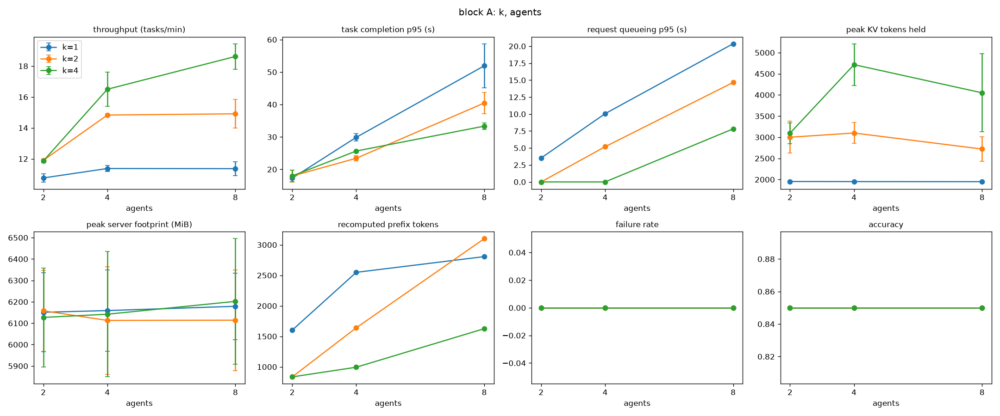
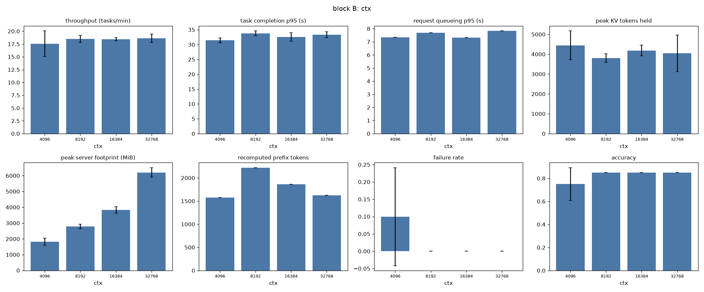
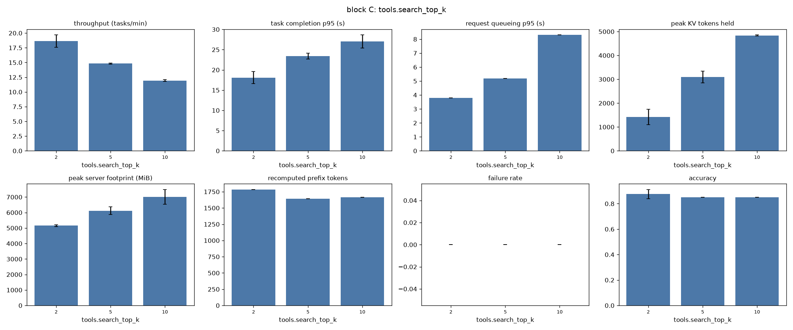
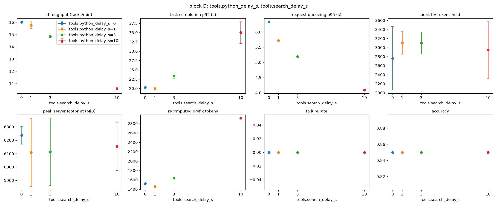
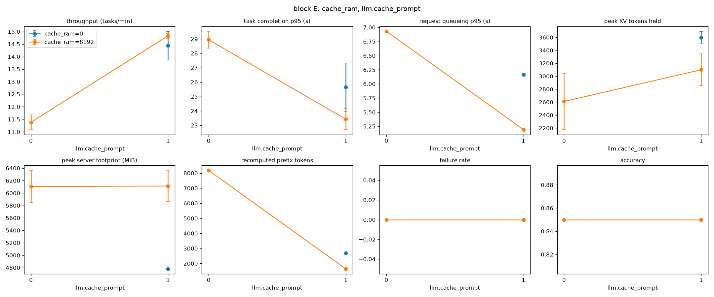
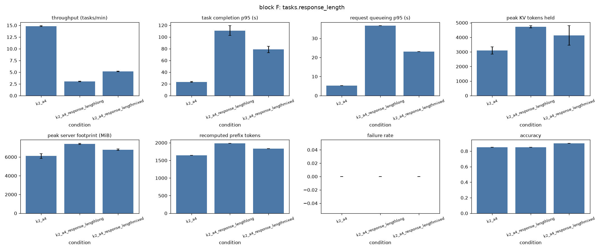
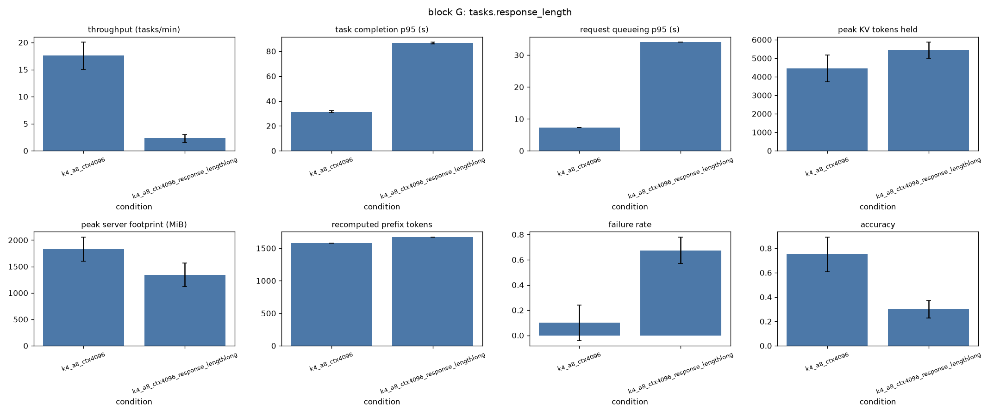
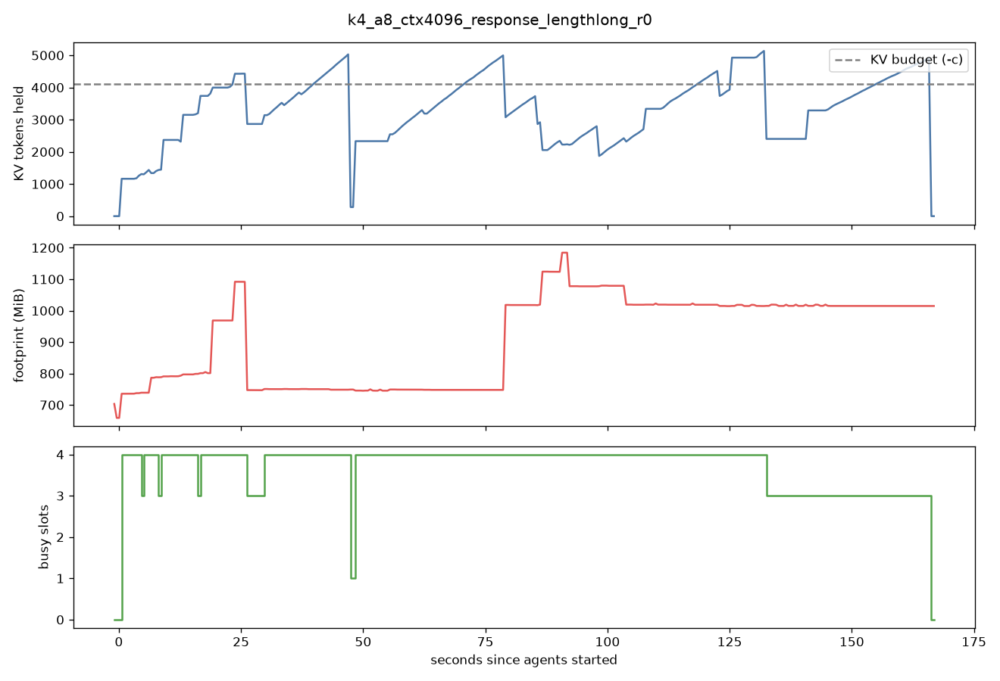

# Phase 1：FIFO 固定并发基线的测量与分析

原始数据和汇总表见 `results/phase1/`（每次运行一个目录，`conditions.csv` 为按条件汇总的结果），实验矩阵见
`experiments/phase1.toml`。

## 1 实验设置

本阶段在一台 MacBook Air（Apple Silicon，10 核，24 GB 统一内存）上进行。推理运行时为 llama.cpp（build 11669），模型为
Qwen3-4B-Instruct-2507 的 Q8_0 量化版本，所有对比中模型和精度保持不变。解码使用 temperature 0。

llama.cpp 服务器以 `-c <ctx> -np 4 -kvu` 启动：4 个槽共享一个容量为 `ctx` 个 token 的 KV 池。对这个模型来说，每个
token 的 KV 占 144 KiB，32K token 约为 4.5 GiB。池在启动时一次性分配。槽中被替换出去的上下文会存入主机内存中的
prompt cache（`--cache-ram`），同一个请求序列回来时可以恢复，不必重新计算。

调度器是一个位于 agent 与服务器之间的 HTTP 代理，所有模型请求进入同一个 FIFO 队列，最多同时转发 K 个。队列长度设得
足够大，实验中不会拒绝请求，因此观察到的失败都来自模型端。

负载由真实数据集上的工具调用 agent 构成：GSM8K 测试集的 10 道题（agent 使用 Python 工具计算），以及 HotpotQA
dev-distractor 的 10 道题（agent 使用 BM25 检索 Wikipedia 段落）。每次运行 20 个任务，顺序打乱，由 N 个闭环 agent
并发执行，每个 agent 完成一个任务后再领取下一个。每次工具调用后额外等待一段固定时间，用于模拟工具延迟。这 20
道题作为开发集，Phase 2 的评测使用其余题目。

基线条件为 K=2、4 个 agent、32K KV 池、8 GB 主机缓存、工具延迟 3 s、检索返回 5 段。此时负载的基本特征如下：

| 类型 | 每任务模型请求数 | 单请求上下文 p50 / 最大 | 单请求输出 p50 / 最大 |
|---|---|---|---|
| GSM8K | 1.9 | 300 / 424 token | 49 / 108 token |
| HotpotQA | 2.3 | 605 / 1921 token | 27 / 67 token |

在基线之上，我们每次只改变一个因素，共 7 组：并发（A）、KV 预算（B）、检索段数即上下文长度（C）、工具延迟即空闲时间（D）、
上下文保留方式（E）、回复长度（F），以及小预算下的长回复（G）。回复长度通过修改系统提示实现：长回复要求在最终答案前给出
500 词以上的解释，评分方式不变。每个条件重复 2 次，下文数值为均值。每次运行前重启服务器，运行顺序随机打乱。

记录的指标包括：任务完成时间（p50/p95）、请求排队时间、吞吐（每分钟完成任务数）、准确率、失败率，以及每 0.5 s
采样一次的服务器内存。内存有两个指标：footprint 是服务器进程实际写过的内存，包括 KV 池、主机缓存和缓冲区，不含按需
映射的模型权重；kv_tokens 是各槽当前持有的 token 数之和。缓存复用用 `cache_n / (cache_n + prompt_n)` 衡量，即请求中
直接复用、无需重新计算的 token 比例。

## 2 结果

### 2.1 并发

| K | 吞吐（2 / 4 / 8 个 agent） | 完成 p50，s | 排队 p95，s | KV 峰值 |
|---|---|---|---|---|
| 1 | 10.8 / 11.4 / 11.4 | 10.1 / 19.7 / 36.1 | 3.5 / 10.1 / 20.4 | 1.9K |
| 2 | 11.9 / 14.8 / 14.9 | 9.0 / 13.7 / 28.1 | 0 / 5.2 / 14.7 | 3.0K |
| 4 | 11.9 / 16.5 / 18.6 | 9.0 / 12.2 / 21.3 | 0 / 0 / 7.8 | 4.7K |

吞吐主要由 K 决定。K 从 1 增加到 2，吞吐提高 31%；从 2 增加到 4，再提高 25%，收益在递减。agent 数超过 K 以后，吞吐
基本不变，完成时间随 agent 数近似线性增长，增加的部分几乎全是排队。以 K=1、8 个 agent 为例，任务总时间中 76% 花在
排队，只有 14% 是模型计算。

这一组中内存不构成约束：KV 峰值只占 32K 池的 6% 到 15%，各条件下的 footprint 峰值都在 6.1 到 6.2 GB 之间。所有条件
的准确率都是 0.85，并发本身不影响结果质量。在开发集上表现最好的固定配置是 K=4。

### 2.2 KV 预算

| KV 池 | footprint 空闲 / 峰值 | 准确率 | 失败率 | 吞吐 |
|---|---|---|---|---|
| 32K | 4.7 / 6.2 GB | 0.85 | 0 | 18.6 |
| 16K | 2.4 / 3.8 GB | 0.85 | 0 | 18.4 |
| 8K | 1.3 / 2.8 GB | 0.85 | 0 | 18.5 |
| 4K | 0.7 / 1.8 GB | 0.75 | 10% | 17.6 |

（K=4，8 个 agent，短回复。）

服务器内存几乎完全由池的大小决定，并且在没有请求时就已经占用。峰值比空闲时多出的约 1.4 GB 来自主机缓存，关闭主机
缓存后这部分消失（见 2.5）。把池缩小到 8K，内存减少 55%，性能没有变化。池缩小到 4K 后开始出现失败：其中一次运行里，
4 个正在执行的请求在 35 ms 内一起失败，错误为 `Context size has been exceeded`。单个请求的上下文远小于 4K，失败的
原因是几个槽的上下文加起来超出了共享池。另一次重复没有失败，说明这种情况取决于哪些任务恰好同时进入上下文较长的阶段。

### 2.3 上下文长度

| 检索段数 | 上下文 p95 | KV 峰值 | 吞吐 | 完成 p95，s | 缓存复用 | footprint 峰值 |
|---|---|---|---|---|---|---|
| 2 | 0.7K | 1.4K | 18.6 | 18.1 | 58% | 5.2 GB |
| 5 | 1.4K | 3.1K | 14.8 | 23.4 | 43% | 6.1 GB |
| 10 | 2.0K | 4.8K | 11.9 | 27.0 | 27% | 7.0 GB |

上下文越长，预填充越贵，吞吐越低；KV 占用和主机缓存占用也随之上升。每一步新加入的检索结果都需要重新计算，所以
上下文越长，能复用的部分所占比例越低。

### 2.4 步骤间空闲

| 工具延迟 | 吞吐 | 完成 p50 / p95，s | 重算 token | 缓存复用 |
|---|---|---|---|---|
| 0 s | 16.0 | 13.4 / 20.3 | 1.5K | 45% |
| 1 s | 15.8 | 13.9 / 20.0 | 1.5K | 45% |
| 3 s | 14.8 | 13.7 / 23.4 | 1.6K | 44% |
| 10 s | 10.6 | 18.3 / 35.0 | 2.9K | 38% |

3 s 以内的延迟影响很小。延迟增加到 10 s 时，重算的 token 接近翻倍：agent 等待工具期间，它所在的槽被其他请求占用，
原来的上下文被替换出去，回来后需要从主机缓存恢复或重新计算。空闲的 agent 不消耗计算，但它的上下文仍占着内存，
空闲时间越长，这部分上下文越可能在它回来之前被替换掉。

### 2.5 上下文保留

| 条件 | 吞吐 | 完成 p50 / p95，s | 重算 token | 缓存复用 | footprint 峰值 |
|---|---|---|---|---|---|
| 默认：槽内 KV + 8 GB 主机缓存 | 14.8 | 13.7 / 23.4 | 1.6K | 44% | 6.1 GB |
| 关闭主机缓存 | 14.4 | 14.0 / 25.7 | 2.7K | 40% | 4.8 GB |
| 关闭前缀复用 | 11.4 | 19.1 / 28.9 | 8.2K | 0% | 6.1 GB |

前缀复用对这个运行时有明显作用。关闭以后每一步都要从头计算整个上下文，吞吐下降 23%，完成时间 p50 增加 39%。主机
缓存占用约 1.3 GB，使重算量减少约 40%，但在当前较短的上下文下，吞吐只差 3%。上下文更长或空闲更久时，这项取舍会更
重要。

### 2.6 回复长度

| 回复 | 输出 p50 / p95 | 吞吐 | 完成 p50 / p95，s | 排队 p95，s | KV 峰值 | footprint 峰值 |
|---|---|---|---|---|---|---|
| 短 | 28 / 79 | 14.8 | 13.7 / 23.4 | 5.2 | 3.1K | 6.1 GB |
| 长 | 329 / 541 | 3.05 | 76.8 / 111 | 36.6 | 4.7K | 7.4 GB |
| 混合 | 50 / 451 | 5.19 | 41.4 / 78.7 | 23.1 | 4.1K | 6.8 GB |

回复长度增加约 10 倍后，吞吐下降 79%，准确率不变（短、长均为 0.85，混合为 0.90），可见解码在总成本中占大头。

混合负载里，短任务和长任务受到的影响不同：

| | 单独运行时 p50 / p95 | 混合时 p50 / p95 |
|---|---|---|
| 短回复任务 | 13.7 / 23.4 s | 26.2 / 51.9 s |
| 长回复任务 | 76.8 / 111 s | 59.6 / 79.8 s |

短任务在混合负载中的 p50 变为原来的 1.9 倍，p95 变为 2.2 倍，原因是它们在 FIFO 队列中排在需要长时间解码的请求后面。
长任务反而比单独运行时快，因为与它竞争的大部分是短请求。所以在 FIFO 下，公平性的主要问题是短任务被长任务拖慢，
而不是长任务被延误。

### 2.7 小预算下的长回复

| 回复 | 失败率（两次重复） | 准确率 | 上下文溢出的请求数 | 吞吐 |
|---|---|---|---|---|
| 短 | 10%（0%，20%） | 0.75 | 2 | 17.6 |
| 长 | 67.5%（75%，60%） | 0.30 | 13.5 | 2.3 |

（K=4，8 个 agent，4K KV 池。）

在 4K 的池中，把回复改长以后，失败率从 10% 升到 67.5%，准确率降到 0.30。上面的时间线呈锯齿形：几个槽同时解码，
KV 占用一起上升，触到池的上限后，正在运行的 3 到 4 个请求同时失败，占用回落，接着又重新上升。第一次运行中的 15
次失败分为 4 组，每组 3 到 4 个请求同时出错，其中 11 次发生在生成最终长回答的那一步。每个请求在被调度时都放得下，
问题出在调度之后解码继续增加的 token 上。

## 3 瓶颈分析

在这台机器上，瓶颈是什么取决于 KV 预算相对负载是否充足。

预算充足时（32K，A 至 F 组的大部分条件），瓶颈是计算。吞吐由 K 决定，延迟主要来自排队，KV 池八成以上处于空闲。
增加 agent 只会让队列更长，增加 K 有效但收益递减；而在计算成本中，解码占主要部分。此时为了不出错而预留的大块内存
实际上没有被使用。

预算紧张时（4K，或者回复变长、上下文在运行中持续增长），瓶颈变成共享 KV 池的总占用。llama.cpp 的池大小固定，并由
所有槽共用，一旦同时运行的请求上下文之和（包括解码中新生成的 token）超过池的大小，正在运行的请求会一起失败。FIFO
加固定 K 的做法只限制同时运行的请求数，而 4 个短请求和 4 个长回复请求所需的 KV 可以相差数倍，因此它要么为最坏情况
预留大量内存，要么在负载变重时成批失败。

并发、上下文增长和空闲时间分别从三个方向影响这种内存压力：并发决定有多少上下文同时在池里，上下文增长（检索结果的
累积和解码）决定每个上下文有多大，空闲时间决定保留下来的上下文能否在 agent 返回前留住。前缀复用本身价值明显，
因此哪些上下文值得保留是一个有实际意义的问题。

## 4 对 Phase 2 的意义

以上结果指向一种按 token 而不是按请求数进行准入的调度：调度器估计每个请求的 KV 需求，即当前上下文长度加上预计的
生成长度，只在所有运行中请求的估计总和低于池容量时才放行新请求。这样在 4K 到 8K 的小预算下可以避免成批失败，在
负载较轻时仍能达到 K=4 的并发。F 组观察到的队头阻塞提示还可以优先调度预计较短的步骤。对比基线为 FIFO 加 K=4（开发集
上最好的固定配置），以及更保守的 K=1 和 K=2。

## 5 局限

每个任务平均只有约 2 次模型请求，上下文增长主要来自检索结果和长回复，而不是多轮交互。单个请求的上下文最长约
2K token，内存压力主要通过缩小 KV 池来制造。每个条件只有 20 个任务、重复 2 次，4K 短回复下的失败只出现在其中一次
重复里。kv_tokens 来自服务器 `/slots` 接口，池满时数值会略高于池容量（最高为 133%），适合比较趋势，不代表精确占用。
所有结果来自同一台无风扇笔记本，绝对数值不能直接推到其他硬件上。
