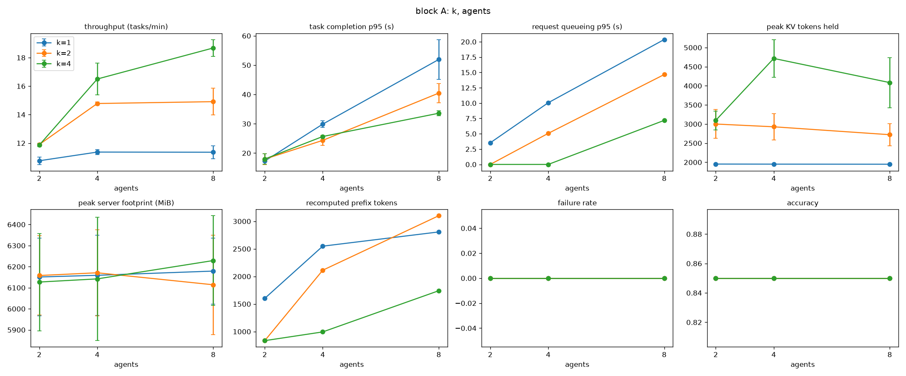
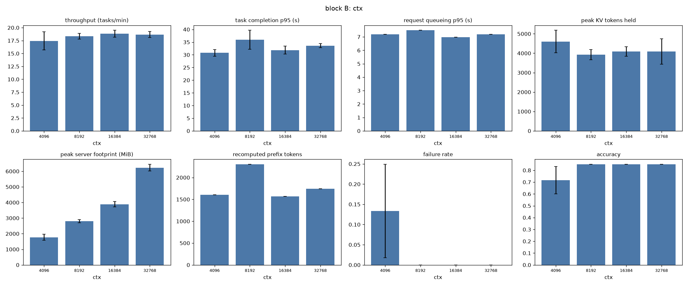
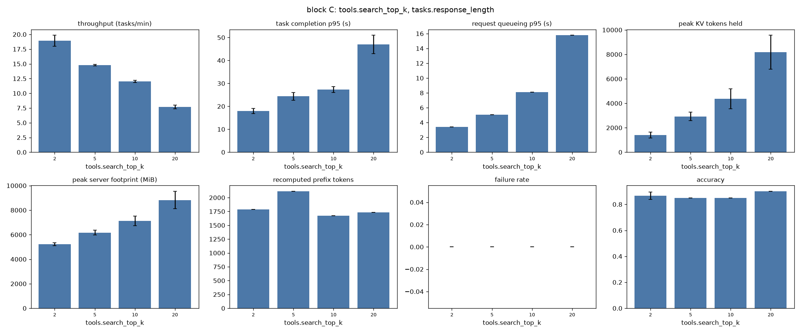
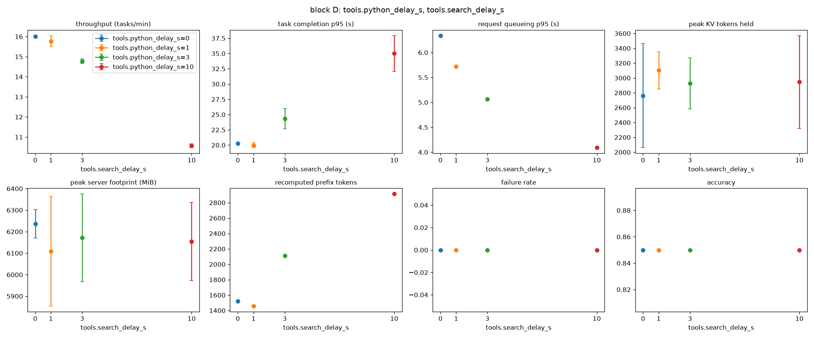
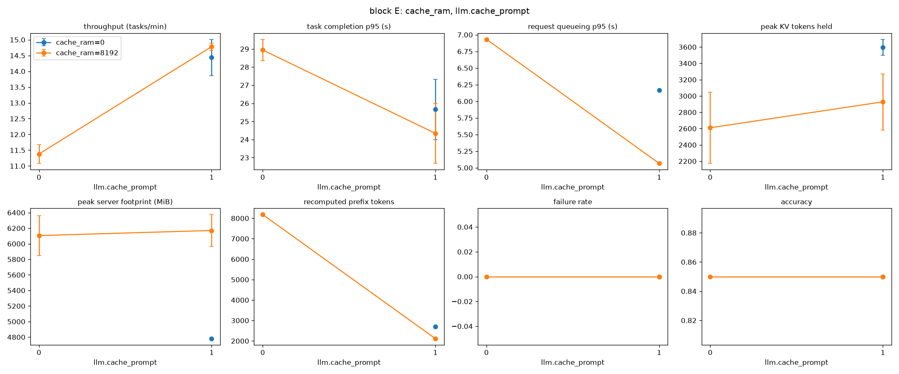
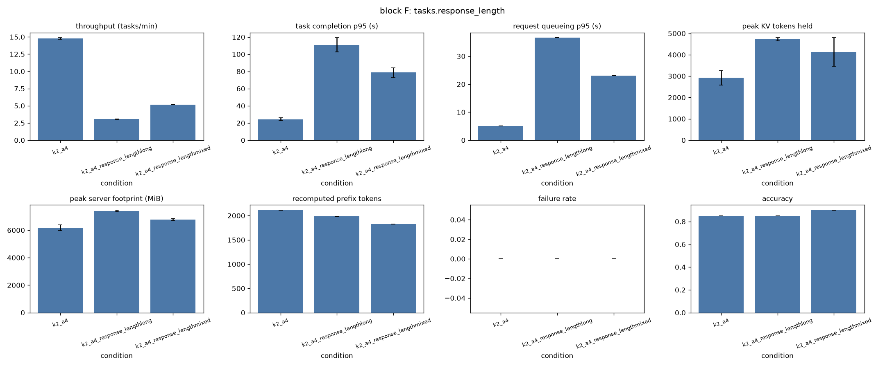
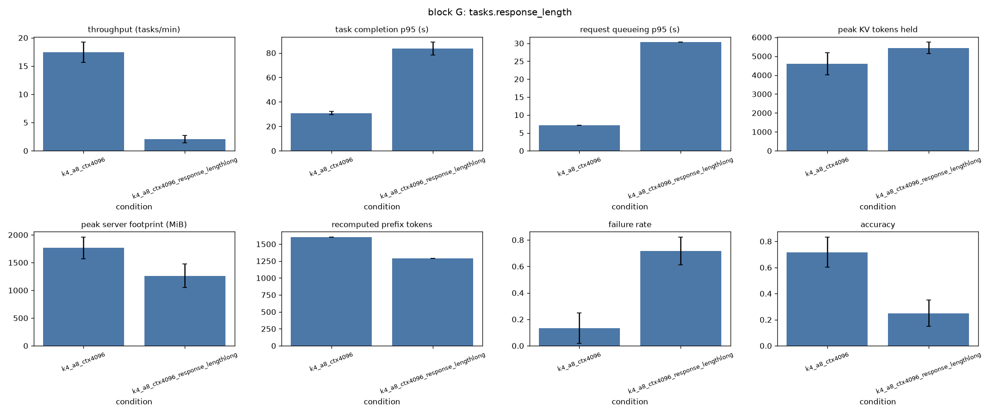
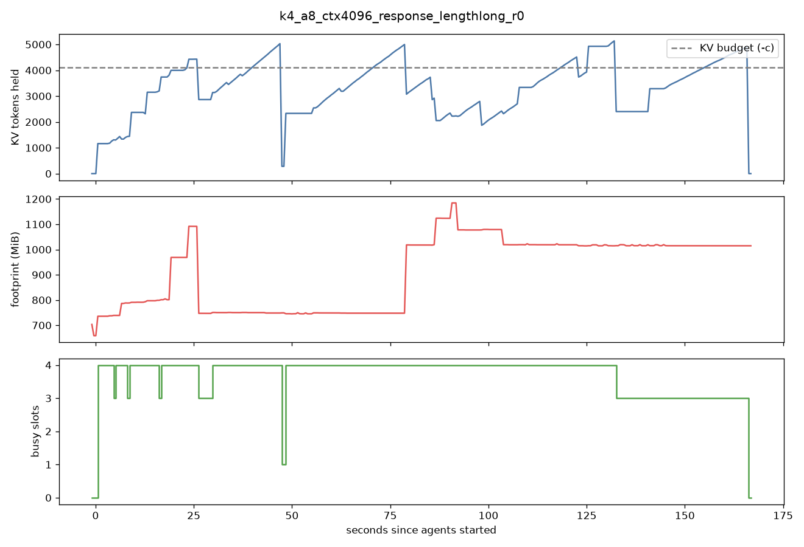
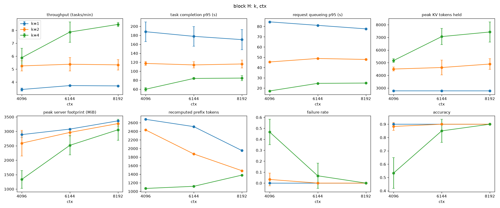
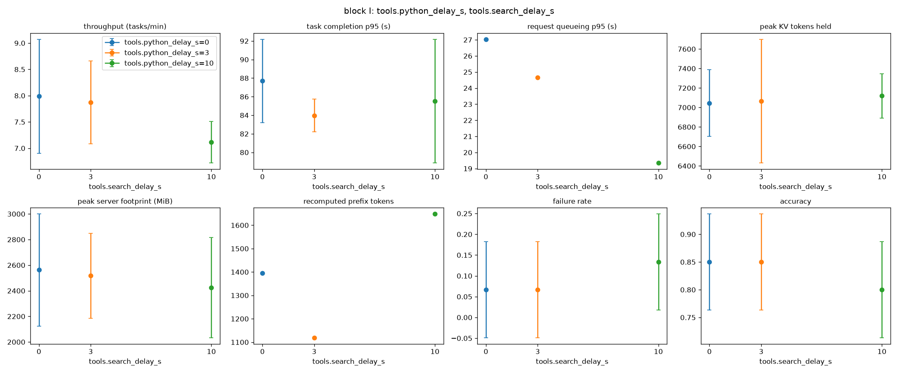

# Phase 1：FIFO 固定并发基线的测量与分析（第二版）

原始数据和汇总表见 `results/phase1/`（每次运行一个目录，`conditions.csv` 为按条件汇总的结果），实验矩阵见
`experiments/phase1.toml`。与第一版相比，本版增加了三组实验（小预算下的并发、小预算下的空闲时间、更长的上下文），
把 B、C、G 组的重复次数从 2 次增加到 3 次，并补充了两项从已有日志中得到的指标：KV 池满的次数和截止时间未达率。

## 1 实验设置

本阶段在一台 MacBook Air（Apple Silicon，10 核，24 GB 统一内存）上进行。推理运行时为 llama.cpp（build 11669），模型为
Qwen3-4B-Instruct-2507 的 Q8_0 量化版本，所有对比中模型和精度保持不变。解码使用 temperature 0。

llama.cpp 服务器以 `-c <ctx> -np 4 -kvu` 启动：4 个槽共享一个容量为 `ctx` 个 token 的 KV 池。对这个模型来说，每个
token 的 KV 占 144 KiB，32K token 约为 4.5 GiB。池在启动时一次性分配。槽中被替换出去的上下文会存入主机内存中的
prompt cache（`--cache-ram`），同一个请求序列回来时可以恢复，不必重新计算。下文把 `ctx` 称为 KV 预算。

调度器是一个位于 agent 与服务器之间的 HTTP 代理，所有模型请求进入同一个 FIFO 队列，最多同时转发 K 个。队列长度设得
足够大，实验中不会拒绝请求，因此观察到的失败都来自模型端。

负载由真实数据集上的工具调用 agent 构成：GSM8K 测试集的 10 道题（agent 使用 Python 工具计算），以及 HotpotQA
dev-distractor 的 10 道题（agent 使用 BM25 检索 Wikipedia 段落）。每次运行 20 个任务，顺序打乱，由 N 个闭环 agent
并发执行，每个 agent 完成一个任务后再领取下一个。每次工具调用后额外等待一段固定时间，用于模拟工具延迟。这 20
道题作为开发集，Phase 2 的评测使用其余题目。

基线条件为 K=2、4 个 agent、32K KV 预算、8 GB 主机缓存、工具延迟 3 s、检索返回 5 段、短回复。此时负载的基本特征如下：

| 类型 | 每任务模型请求数 | 单请求上下文 p50 / 最大 | 单请求输出 p50 / 最大 |
|---|---|---|---|
| GSM8K | 1.9 | 300 / 424 token | 49 / 108 token |
| HotpotQA | 2.3 | 605 / 1921 token | 27 / 67 token |

在基线之上，每组实验只改变一个因素（H 组改变两个），共 9 组：

| 组 | 因素 | 取值 | 重复 |
|---|---|---|---|
| A | 并发：K × agent 数 | K 1/2/4 × agent 2/4/8 | 2 |
| B | KV 预算（K=4，8 agent） | 4K / 8K / 16K / 32K | 3 |
| C | 检索段数（上下文长度） | 2 / 5 / 10 / 20 | 3 |
| D | 工具延迟（步骤间空闲） | 0 / 1 / 3 / 10 s | 2 |
| E | 上下文保留 | 默认 / 关主机缓存 / 关前缀复用 | 2 |
| F | 回复长度 | 短 / 长 / 混合 | 2 |
| G | 4K 预算下的回复长度（K=4，8 agent） | 短 / 长 | 3 |
| H | 小预算下的并发（8 agent，混合回复） | K 1/2/4 × 预算 4K/6K/8K | 3 |
| I | 小预算下的空闲（K=4，8 agent，6K，混合回复） | 0 / 3 / 10 s | 3 |

回复长度通过修改系统提示实现：长回复要求在最终答案前给出 500 词以上的解释（最终回复 330 至 700 token），混合负载中一半
任务为长回复。评分方式不变。每次运行前重启服务器，运行顺序随机打乱，下文数值为各重复的均值。

记录的指标包括：任务完成时间（p50/p95）、请求排队时间、吞吐（每分钟完成任务数）、准确率、失败率、截止时间未达率
（120 s 内未完成或失败的任务比例），以及每 0.5 s 采样一次的服务器内存。内存方面有三个指标：footprint 是服务器进程
实际写过的内存，包括 KV 池、主机缓存和缓冲区，不含按需映射的模型权重；kv_tokens 是各槽持有的 token 数之和，由服务器
`/slots` 接口计算，池满时会略高于预算，只用于比较趋势；KV 池满次数统计服务器日志中 "failed to find free space in
the KV cache" 的出现次数，这是运行时直接报告的内存压力信号，在没有出现失败的运行中始终为 0。缓存复用用
`cache_n / (cache_n + prompt_n)` 衡量，即请求中直接复用、无需重新计算的 token 比例。

## 2 结果

### 2.1 并发（32K 预算）

| K | 吞吐（2 / 4 / 8 个 agent） | 完成 p50，s | 排队 p95，s | KV 峰值 |
|---|---|---|---|---|
| 1 | 10.8 / 11.4 / 11.4 | 10.1 / 19.7 / 36.1 | 3.5 / 10.1 / 20.4 | 1.9K |
| 2 | 11.9 / 14.8 / 14.9 | 9.0 / 13.9 / 28.1 | 0 / 5.1 / 14.7 | 2.9K |
| 4 | 11.9 / 16.5 / 18.7 | 9.0 / 12.2 / 21.1 | 0 / 0 / 7.2 | 4.7K |

吞吐主要由 K 决定。K 从 1 增加到 2，吞吐提高 31%；从 2 增加到 4，再提高 25%，收益在递减。agent 数超过 K 以后，吞吐
基本不变，完成时间随 agent 数近似线性增长，增加的部分几乎全是排队。以 K=1、8 个 agent 为例，任务总时间中 76% 花在
排队，只有 14% 是模型计算。

32K 预算下内存不构成约束：KV 峰值只占预算的 6% 到 15%，各条件下的 footprint 峰值都在 6.1 到 6.2 GB 之间，没有出现
KV 池满。所有条件的准确率都是 0.85。在这一预算下表现最好的固定配置是 K=4。

### 2.2 KV 预算

| KV 预算 | footprint 空闲 / 峰值 | 准确率 | 失败率（各次） | KV 池满次数 | 吞吐 |
|---|---|---|---|---|---|
| 32K | 4.7 / 6.2 GB | 0.85 | 0 | 0 | 18.7 |
| 16K | 2.4 / 3.9 GB | 0.85 | 0 | 0 | 18.8 |
| 8K | 1.3 / 2.8 GB | 0.85 | 0 | 0 | 18.3 |
| 4K | 0.7 / 1.8 GB | 0.72 | 13%（0，20%，20%） | 29 | 17.4 |

（K=4，8 个 agent，短回复。）

服务器内存几乎完全由预算决定，并且在没有请求时就已经占用。峰值比空闲时多出的约 1.5 GB 来自主机缓存，关闭主机缓存后
这部分消失（见 2.5）。预算缩小到 8K，内存减少 55%，性能没有变化。缩小到 4K 后开始出现失败：失败总是几个正在执行的
请求在几十毫秒内一起出错，错误为 `Context size has been exceeded`。单个请求的上下文远小于 4K，失败的原因是几个槽的
上下文加起来超出了共享池。三次重复中有一次没有失败，说明这取决于哪些任务恰好同时进入上下文较长的阶段。

### 2.3 上下文长度

| 检索段数 | 上下文 p95 | KV 峰值 | 吞吐 | 完成 p95，s | 缓存复用 | footprint 峰值 |
|---|---|---|---|---|---|---|
| 2 | 0.7K | 1.4K | 18.9 | 17.9 | 58% | 5.2 GB |
| 5 | 1.4K | 2.9K | 14.8 | 24.3 | 41% | 6.2 GB |
| 10 | 2.0K | 4.4K | 12.0 | 27.3 | 27% | 7.1 GB |
| 20 | 3.7K | 8.2K | 7.7 | 47.0 | 17% | 8.8 GB |

（K=2，4 个 agent，32K 预算。）

上下文越长，预填充越贵，吞吐越低：检索段数从 2 增加到 20，单请求上下文 p95 从 0.7K 增加到 3.7K，吞吐下降 59%。KV
占用和主机缓存占用随之上升，footprint 峰值从 5.2 GB 增加到 8.8 GB。每一步新加入的检索结果都需要重新计算，所以上下文
越长，能复用的部分所占比例越低。准确率没有下降（0.85 至 0.90）。

### 2.4 步骤间空闲（32K 预算）

| 工具延迟 | 吞吐 | 完成 p50 / p95，s | 重算 token | 缓存复用 |
|---|---|---|---|---|
| 0 s | 16.0 | 13.4 / 20.3 | 1.5K | 45% |
| 1 s | 15.8 | 13.9 / 20.0 | 1.5K | 45% |
| 3 s | 14.8 | 13.9 / 24.3 | 2.1K | 41% |
| 10 s | 10.6 | 18.3 / 35.0 | 2.9K | 38% |

（K=2，4 个 agent。）

1 s 以内的延迟几乎没有影响。延迟越长，需要重算的 token 越多：agent 等待工具期间，它所在的槽被其他请求占用，原来的
上下文被替换出去，回来后需要从主机缓存恢复或重新计算。空闲的 agent 不消耗计算，但它的上下文仍占着内存，空闲时间
越长，这部分上下文越可能在它回来之前被替换掉。

### 2.5 上下文保留（32K 预算）

| 条件 | 吞吐 | 完成 p50 / p95，s | 重算 token | 缓存复用 | footprint 峰值 |
|---|---|---|---|---|---|
| 默认：槽内 KV + 8 GB 主机缓存 | 14.8 | 13.9 / 24.3 | 2.1K | 41% | 6.2 GB |
| 关闭主机缓存 | 14.4 | 14.0 / 25.7 | 2.7K | 40% | 4.8 GB |
| 关闭前缀复用 | 11.4 | 19.1 / 28.9 | 8.2K | 0% | 6.1 GB |

（K=2，4 个 agent。）

前缀复用对这个运行时有明显作用：关闭以后每一步都要从头计算整个上下文，吞吐下降 23%，完成时间 p50 增加 37%。主机
缓存占用约 1.4 GB，使重算量减少约 22%，但在当前较短的上下文下，吞吐只差 3%。

### 2.6 回复长度（32K 预算）

| 回复 | 输出 p50 / p95 | 吞吐 | 完成 p50 / p95，s | 排队 p95，s | KV 峰值 | footprint 峰值 |
|---|---|---|---|---|---|---|
| 短 | 28 / 79 | 14.8 | 13.9 / 24.3 | 5.1 | 2.9K | 6.2 GB |
| 长 | 329 / 541 | 3.05 | 76.8 / 111 | 36.6 | 4.7K | 7.4 GB |
| 混合 | 50 / 451 | 5.19 | 41.4 / 78.7 | 23.1 | 4.1K | 6.8 GB |

（K=2，4 个 agent。）

回复长度增加约 10 倍后，吞吐下降 79%，准确率不变（短、长均为 0.85，混合为 0.90），可见解码在总成本中占大头。

混合负载里，短任务和长任务受到的影响不同：

| | 单独运行时 p50 / p95 | 混合时 p50 / p95 |
|---|---|---|
| 短回复任务 | 13.9 / 24.3 s | 26.2 / 51.9 s |
| 长回复任务 | 76.8 / 111 s | 59.6 / 79.8 s |

短任务在混合负载中的 p50 变为原来的 1.9 倍，p95 变为 2.1 倍，原因是它们在 FIFO 队列中排在需要长时间解码的请求后面。
长任务反而比单独运行时快，因为与它竞争的大部分是短请求。在 FIFO 下，公平性的主要问题是短任务被长任务拖慢。

### 2.7 小预算下的长回复

| 回复 | 失败率（各次） | 准确率 | KV 池满次数 | 吞吐 |
|---|---|---|---|---|
| 短 | 13%（0，20%，20%） | 0.72 | 29 | 17.4 |
| 长 | 72%（75%，60%，80%） | 0.25 | 115 | 2.07 |

（K=4，8 个 agent，4K 预算。）

在 4K 预算下把回复改长以后，失败率从 13% 升到 72%，准确率降到 0.25。上面的时间线呈锯齿形：几个槽同时解码，KV 占用
一起上升，触到预算上限后，正在运行的 3 到 4 个请求同时失败，占用回落，接着又重新上升。以第一次运行为例，15 次失败
分为 4 组，每组 3 到 4 个请求同时出错，其中 11 次发生在生成最终长回答的那一步。每个请求在被调度时都放得下，问题出在
调度之后解码继续增加的 token 上。

### 2.8 小预算下的并发

| | 4K 预算 | 6K 预算 | 8K 预算 |
|---|---|---|---|
| K=1 | 吞吐 3.43，失败 0，池满 0 | 3.73，0，0 | 3.71，0，0 |
| K=2 | 5.25，失败 3%，池满 3.7 | 5.38，0，0 | 5.33，0，0 |
| K=4 | 5.89，失败 47%，池满 85 | 7.87，失败 7%，池满 12 | 8.46，0，0 |

（8 个 agent，混合回复。每格依次为吞吐、失败率、KV 池满次数。）

| | 准确率（4K / 6K / 8K） | 完成 p50，s（4K / 6K / 8K） | 120 s 截止未达率（4K / 6K / 8K） |
|---|---|---|---|
| K=1 | 0.90 / 0.90 / 0.90 | 128 / 118 / 118 | 57% / 50% / 48% |
| K=2 | 0.88 / 0.90 / 0.90 | 81 / 82 / 78 | 5% / 3% / 5% |
| K=4 | 0.53 / 0.85 / 0.90 | 34 / 47 / 46 | 47% / 7% / 0 |

这一组把 A 组的并发实验放到了较小的预算下。8K 时与 32K 下的结论一致：K=4 吞吐最高（8.46），且没有失败。预算缩小后，
并发越高，内存压力越大：4K 下 KV 池满次数从 K=1 的 0、K=2 的 3.7 增加到 K=4 的 85，K=4 有将近一半任务失败，准确率
降到 0.53。K=1 在所有预算下都没有失败，因为任何时刻只有一个请求在使用池，但吞吐只有 K=4 的 44% 到 58%，有一半左右
的任务超过 120 s 才完成。

所以最好的固定并发取决于预算：8K 时是 K=4；4K 时 K=4 的吞吐虽然略高于 K=2，但把失败算进去以后，K=2（失败 3%，
准确率 0.88）明显更好；6K 处于两者之间，K=4 吞吐最高，但有 7% 的失败。一个固定的 K 无法同时适应不同的预算和负载。

还需要注意，K=4、4K 时完成时间 p50 和 p95 反而是三个预算中最低的，原因是失败的任务提前结束，拉低了统计值。比较延迟
时必须同时看失败率和准确率。

### 2.9 小预算下的步骤间空闲

| 工具延迟 | KV 池满次数 | 失败率 | 准确率 | 吞吐 | 重算 token |
|---|---|---|---|---|---|
| 0 s | 7.7 | 6.7% | 0.85 | 7.99 | 1.4K |
| 3 s | 12.3 | 6.7% | 0.85 | 7.87 | 1.1K |
| 10 s | 20.7 | 13.3% | 0.80 | 7.12 | 1.7K |

（K=4，8 个 agent，6K 预算，混合回复。）

在 6K 预算下，工具延迟越长，KV 池满的次数越多（7.7、12.3、20.7），失败率在 10 s 时也有所上升。不过各次重复之间失败率
的标准差约为 12 个百分点，三个条件之间的失败率差别还在这个范围内，只能说有上升的趋势。一个可能的解释是：空闲的 agent
回来时，它被换出的上下文需要重新装入池中，而这时其他 agent 的上下文也在池里，空闲越长，这种同时装入的情况越多。

## 3 瓶颈分析

在这台机器上，瓶颈是什么取决于 KV 预算相对负载是否充足。

预算充足时（32K，以及混合负载下的 8K），瓶颈是计算。吞吐由 K 决定，延迟主要来自排队，KV 池大部分处于空闲。增加
agent 只会让队列更长，增加 K 有效但收益递减；而在计算成本中，解码占主要部分。此时为了不出错而预留的大块内存实际上
没有被使用。

预算紧张时（4K 到 6K，或者回复变长、上下文在运行中持续增长），瓶颈变成共享 KV 池的总占用。llama.cpp 的池大小固定，
由所有槽共用，一旦同时运行的请求上下文之和（包括解码中新生成的 token）超过池的大小，正在运行的请求会一起失败。FIFO
加固定 K 的做法只限制同时运行的请求数，而 4 个短请求和 4 个长回复请求所需的 KV 可以相差数倍。H 组的结果说明，在这种
情况下没有一个固定的 K 能同时做到高吞吐和不失败：K 大了会成批失败，K 小了吞吐只有一半，大量任务超过截止时间。

并发、上下文增长和空闲时间分别从三个方向影响这种内存压力。并发决定有多少上下文同时在池里（H 组：4K 下池满次数
0、3.7、85）；上下文增长，包括检索结果的累积和解码，决定每个上下文有多大（C、F、G 组）；空闲时间决定保留下来的上下文
能否在 agent 返回前留住（D 组），在小预算下还会增加池满的次数（I 组）。前缀复用本身价值明显（E 组），因此哪些上下文
值得保留是一个有实际意义的问题。

## 4 局限

- 每个任务平均只有约 2 次模型请求。我们尝试过让 agent 分步调用工具的提示词，但这个模型的行为变化不大（HotpotQA 从
  2.3 步增加到 2.9 步，GSM8K 反而减少），因此保留原负载。上下文增长主要来自检索结果和长回复，而不是多轮交互。
- A、D、E、F 组每个条件只重复了 2 次；I 组中失败率的差别在重复间的波动范围内。
- kv_tokens 由 `/slots` 计算，池满时会超过预算（最高约 133%），只用于比较趋势；KV 池满次数是精确的，但只反映池满的
  频率，不反映占用量。
- 所有结果来自同一台统一内存的笔记本：CPU 和 GPU 共用一块内存，无法区分显存和主机内存，主机缓存的存取几乎没有搬运
  开销。在显存和主机内存分开的机器上，这些代价会不同，绝对数值也不能直接推到其他硬件上。
